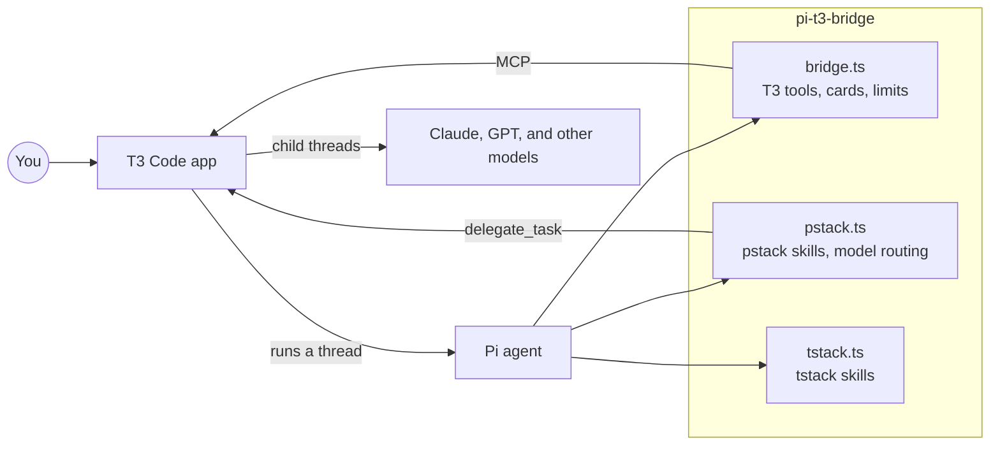
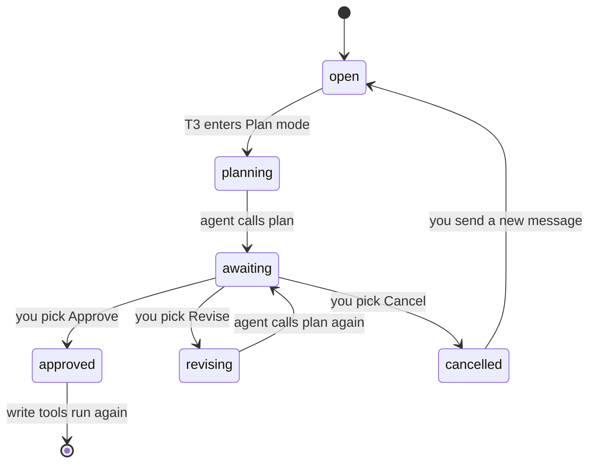
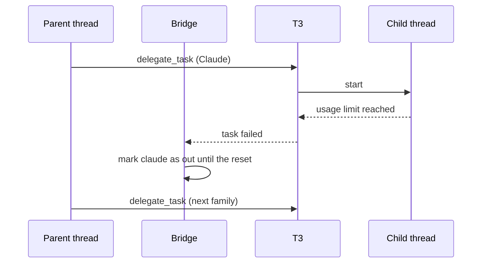
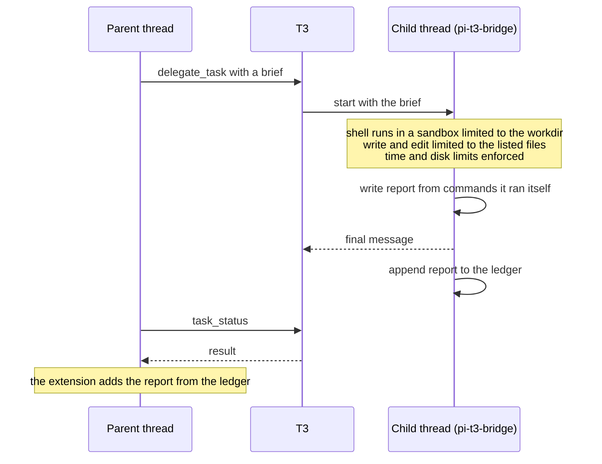

# pi-t3-bridge

pi-t3-bridge is a [Pi](https://pi.dev) package that lets Pi run as an agent inside [T3 Code](https://github.com/pingdotgg/t3code). It also ships the pstack and tstack skill sets.



## Requirements

You need the following programs:

- Node.js 22.19.0 or later
- Pi 1.4.0 or later
- T3 Code, if you want to run Pi threads inside T3 or call T3 tools from Pi

A delegated child runs its shell commands in a sandbox, which is `sandbox-exec` on macOS and `bwrap` (bubblewrap) on Linux and WSL2. On Linux you need the `bubblewrap` package and unprivileged user namespaces. The Ubuntu `bubblewrap` package ships an AppArmor profile that lets `bwrap` run (checked on 26.04). If AppArmor still blocks `bwrap`, run `sudo sysctl -w kernel.apparmor_restrict_unprivileged_userns=0`.

Inside the sandbox a child can write only to its workdir, its git directory, the tool caches, the pnpm store, and the system temp folder. The git hooks and git config stay read-only, because the parent runs them later outside the sandbox. Each child gets its own `XDG_RUNTIME_DIR` in the temp folder, where pnpm takes its store lock. The child also gets `pnpm_config_store_dir` set to the store that `pnpm store path` names for the workdir outside the sandbox, so it shares the parent's store. Under `bwrap`, pnpm copies packages from the store, because Linux refuses hardlinks across the sandbox's mounts. Children skip install scripts (`npm_config_ignore_scripts` and `pnpm_config_ignore_scripts` are `true`), so a root `prepare` such as `lefthook install` does not run. With this setting npm also skips the pre and post scripts of `npm run` and `npm test`, while pnpm still runs them. Steps that only a postinstall runs must run through the build or typecheck the brief names.

The child also gets `TMPDIR` set. On Linux the child cannot see or signal processes outside its own commands, so a stray `pkill` cannot reach a daemon on the host, and anything a command starts in the background dies when that command ends. Chrome, Electron and headless shells need `--no-sandbox` inside the sandbox, because their own namespace sandbox cannot nest under bwrap; the sandbox already confines them. A `pi` run inside the sandbox needs `PI_CODING_AGENT_DIR` pointing at a writable temp copy of `~/.pi/agent`, because the real one is read-only. The disk limit in a brief ignores `node_modules`, which pnpm fills from the store.

Native Windows and WSL1 have no sandbox. Where no sandbox can run, the bridge blocks a child's shell commands, unless you set `childSandbox` to `"off"` in the settings file.

## Install

Install the package with Pi:

```bash
pi install npm:pi-t3-bridge
```

Pi loads every extension in the package on the next start. To try the package for one session without saving it to your settings, run `pi -e npm:pi-t3-bridge`.

## What is in the package

The package has three Pi extensions, and you can turn off any of them. None of the extensions needs another one to be loaded, although `pstack.ts` reuses code from `src/bridge`.

```text
pi-t3-bridge/
├── bridge.ts       # connects Pi to T3 Code
├── pstack.ts       # serves pstack skills and picks models for subagents
├── tstack.ts       # serves tstack skills
├── src/
│   ├── bridge/     # code for bridge.ts
│   └── pstack/     # code for pstack.ts
├── pstack/         # upstream pstack skills, agents, and model defaults
├── overlay/        # the changes Pi needs on top of pstack/
└── tstack/         # Theo Browne's tstack skills
```

To load only some extensions, list the package in `~/.pi/agent/settings.json` in its object form:

```json
{
  "packages": [{ "source": "npm:pi-t3-bridge", "extensions": ["bridge.ts"] }]
}
```

## The bridge extension

The bridge gives Pi the tools and commands that T3 Code expects, and it shows them as cards in the T3 chat. When another installed package already registers a tool with the same name, e.g. `ask` from pi-ask, the bridge keeps the other package's tool and tells you once that its own copy is off.

| Name | Kind | What it does |
| --- | --- | --- |
| `tasks` | tool | Shows the task list for the run as a card in the chat. |
| `plan` | tool | Shows a plan card with Approve, Revise, and Cancel buttons. |
| `ask` | tool | Asks you one or more questions as cards and waits for your answers. |
| `transcript` | tool | Returns the session file and session ID, for workflows that read the transcript. |
| `/t3-usage` | command | Shows the cost of the thread and its children, the cache hit rate, and which model families are out of usage. |
| `/t3-transcript` | command | Records the transcript reference and shows the session file path. |
| `/t3-exhausted <family> [reset time]` | command | Marks a model family as out of usage for every chat on the machine. |
| `/t3-recovered <family>` | command | Marks a model family as usable again for every chat on the machine. |

### Plan mode

When T3 is in Plan mode, or when a plan card waits for your answer, the bridge blocks every tool that can change files. Read-only tools still run, so the agent can read files while you decide.



### Calls to T3 from a terminal

When you run Pi in a terminal instead of a T3 thread, the bridge connects Pi to T3's MCP server, which is the endpoint where T3 Code serves its tools. You can then start threads, send messages to them, and wait on them from the terminal, and the status bar shows whether the connection works.

```text
on(session start)
  if Pi runs inside a T3 thread
    use the tools T3 already gives the thread
  else
    connect to http://127.0.0.1:3773/mcp
    hide the tools that only work inside a T3 thread
    every 3 seconds, update the status bar
      "connected, N tools"
      "offline, start T3 Code"
      "not signed in, run /mcp login t3"
```

### Usage limits and resume

The bridge records which model families are out of usage, and every Pi session on the machine reads the same record. When a child fails with a usage limit, the bridge marks the family as out until its reset time, so pstack sends new work to another family.



The main thread's own account can also run out, and then the agent can't call any tool. When the main thread's account runs out, the bridge asks T3 to post a resume message into the thread just after the reset time.

### Shell time limit

The bridge stops any shell command after 300 seconds, in the main thread and in children, so a test suite that hangs stops the chat for 5 minutes at most. A command can ask for a shorter timeout but not a longer one, and you can change the limit with `bashTimeoutSeconds` in the settings file.

### Stop checks

When a run is about to stop, the bridge asks a classifier model how the run ended, and it gives the agent one more turn when the agent gave up partway. The checks come from [pi-mast-steer](https://github.com/dbreunig/pi-mast-steer).

```text
on(run about to stop)
  ask the classifier how the run ended
  if the classifier is down or takes more than 5 seconds
    let the run stop
  if the agent gave up partway
    if a stop note was already sent for the current prompt
      log the check as capped in steer.jsonl and let the run stop
    add a note
    continue for one more turn

every 3 turns
  ask the classifier whether the agent shows a known failure
  if one is likely
    add a note that names it
```

The known failures come from the MAST list of agent failures:

- Stuck in a loop
- Doesn't know when to stop
- Wandered off
- Broke the brief, or says one thing and does another

The bridge picks the classifier in the order below, and it doesn't fall back to the next one when the chosen one fails.

```text
pick classifier
  if classifierModel is set in the settings file
    use that chat model, or report an error if it's not in the catalog or has no auth
  else if typesafe/jev-latest is in your Pi model catalog and you have access
    use Jev
  else
    use the session model
```

A chat model answers the same questions through one tool call. Its probabilities are its own guesses and not calibrated like Jev's, and the thresholds were fitted on Jev, so a chat model may add notes more or less often. A chat model also costs tokens on your account, with one call per stop check and one every 3 turns. Set `steer` to `"shadow"` to log the verdicts without changing the session, or to `"off"` to turn the checks off.

## The pstack extension

The pstack extension adds the pstack skills to Pi's skill list, and it adds a note to each prompt that tells the agent when to enter `poteto-mode`. The `poteto-mode` skill picks the workflow that fits your goal, e.g. a bug fix, a feature, a design review, or a PR watch.

The skills come from [pstack](https://github.com/cursor/plugins/tree/main/pstack) by way of [t3-pstack](https://github.com/chhoumann/t3-pstack). The `pstack/` folder holds the upstream text unchanged, and `overlay/` holds the changes Pi needs.

```text
on(Pi start)
  copy pstack/ to ~/.local/state/pi-t3/pstack-overlay/<hash>/
  apply each change in overlay/ to the copy
  serve the skills from the copy
```

When a change in `overlay/` no longer matches a new upstream text, the test run fails and names the file.

### Model routing

The `pstack_model` tool picks the model for each subagent. The agent passes a role, a job type, and a size, and the tool returns a target that the agent passes to T3's `delegate_task`.

```text
pstack_model(role, job, size)
  if size is L
    refuse, so the agent splits the job
  if the model sheet names a model for the role
    use the model from the sheet
  else
    look up the job and size in the routing table
  if the model's family is out of usage
    use the same tier in the next family
    (GPT takes only size S work)
  return the target for delegate_task
```

The routing table lives in `pstack/models.json`. Size S is a job of 30 minutes or less that touches 5 files or fewer, and size M is a job of 90 minutes or less that touches 15 files or fewer.

| Job | Size S | Size M |
| --- | --- | --- |
| `mechanical`, e.g. a lint fix or rename | Haiku 5.5, low | Sonnet 5.5, medium |
| `check`, which runs given commands | GPT 6 Luna, low | Haiku 5.5, medium |
| `research`, which writes one notes file | Muse Spark 1.3, medium | Muse Wonder 1.0, medium |
| `implement`, one unit with named tests | GPT 6.1 Sol, medium | Sonnet 5.5, high |
| `hard`, e.g. concurrency or a bug with an unknown cause | Opus 5.5, high | Opus 5.5, high |
| `review` panel | Opus 5.5, Muse Wonder Full 1.0, and GPT 6.1 Sol, all high | same |
| `design` panel | Opus 5.5, Muse Wonder Full 1.0, and GPT 6 Astra, all high | same |

To choose your own models, run the `setup-pstack` skill, which writes a model sheet at `~/.config/pi-t3-bridge/models.md`. A line of `session hook: off` in the sheet stops the note about `poteto-mode` on each prompt.

### Limits for delegated children

When the first message of a session is a complete pstack brief, the extension treats the session as a delegated child and holds it to the limits in the brief. The child can't lift the limits through anything it writes. A T3-delegated child whose brief has a `# Task:` heading but misses a section or a header field gets every tool blocked, with a list of what is missing, so it never runs without the sandbox.



## The tstack extension

The tstack extension serves Theo Browne's tstack skills from `tstack/skills`, which are babysit-pr, council, file-pr, full-send, full-stop, leaving-pr-comments, modernize, sol-loop, and takeover. It imports no other code from the package, so the skills stay available when you turn the other extensions off.

## Settings

The bridge reads one JSON file per machine, at `~/.config/pi-t3/config.json`. Every key is optional. The bridge reads the file again on each prompt, so an edit applies on the next prompt. When a value is invalid, only the invalid key falls back to its default, and the bridge tells you once.

```json
{
  "bashTimeoutSeconds": 300,
  "childSandbox": "on",
  "classifierModel": "anthropic/claude-sonnet-4-5",
  "mcpUrl": "http://127.0.0.1:3773/mcp",
  "steer": "on"
}
```

| Key | Default | Meaning |
| --- | --- | --- |
| `bashTimeoutSeconds` | `300` | The longest a shell command can run, in seconds. |
| `childSandbox` | `"on"` | With `"on"`, a child's `bash` is blocked when no sandbox can run. With `"off"`, commands run with no sandbox on every platform, and the child's report says `SANDBOX: off`. |
| `classifierModel` | unset | The chat model that runs the stop checks, as `"provider/modelId"`. The model ID may contain more slashes. |
| `mcpUrl` | `http://127.0.0.1:3773/mcp` | The T3 MCP endpoint to use from a terminal. |
| `steer` | `"on"` | The stop checks, as `"on"`, `"shadow"`, or `"off"`. |

The package writes its files in the places below. When `XDG_CONFIG_HOME` or `XDG_STATE_HOME` is set, the folder it names replaces `~/.config` or `~/.local/state`.

```text
~/.config/
├── pi-t3/config.json          # bridge settings
└── pi-t3-bridge/models.md     # model sheet, written by setup-pstack
~/.local/state/pi-t3/
├── accounts.json              # model families that are out of usage
├── ledger.jsonl               # one line per delegated brief, with cost and report
├── steer.jsonl                # one line per stop check verdict, with no transcript text
└── pstack-overlay/            # pstack skills with the Pi changes applied
```

Earlier releases kept the state and the model sheet under `t3-pstack`, and the first start after an upgrade moves them to the new folders.

## Data handling

The package has no server and sends no telemetry. The stop checks send parts of the session transcript to the classifier's provider, and any file a skill asks the agent to read goes to your model provider. Scripts run on your machine, and the PR tools use your GitHub CLI login.

## Development

The repository uses npm. The tests need Docker, because they also run the child tests in Linux containers.

```bash
npm install
npm test           # node:test suites for the bridge and the pstack scripts
npm run typecheck
npm run check      # Ultracite lint and format check
```

The `pstack/` folder is a git subtree of t3-pstack. To take upstream changes, run `git merge -X subtree=pstack pstack-upstream`, and put Pi changes in `overlay/` instead of editing `pstack/`.

## License

The package uses the MIT license. The copyright holders include the following people and companies:

- Lauren Tan, for the original pstack
- Cursor, for the imported cursor-team-kit and thermos skills
- Christian Bager Bach Houmann, for the T3 changes in t3-pstack

See [LICENSE](LICENSE) and [NOTICE.md](pstack/skills/poteto-mode/references/licenses/NOTICE.md) for the full list.
